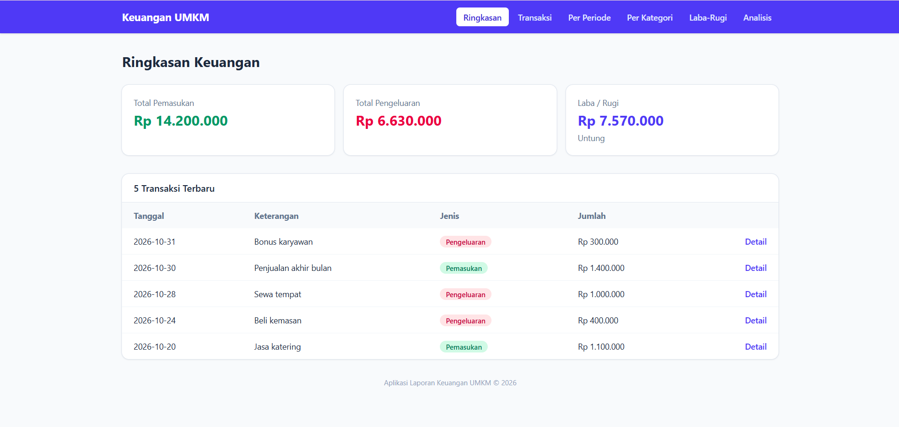
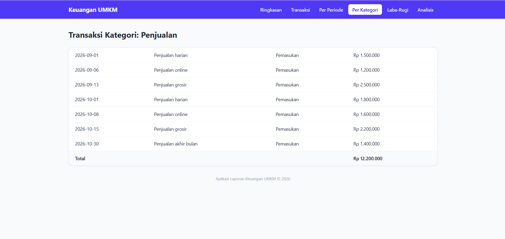
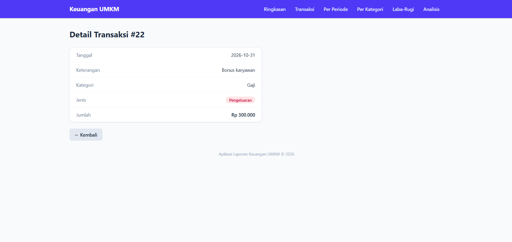
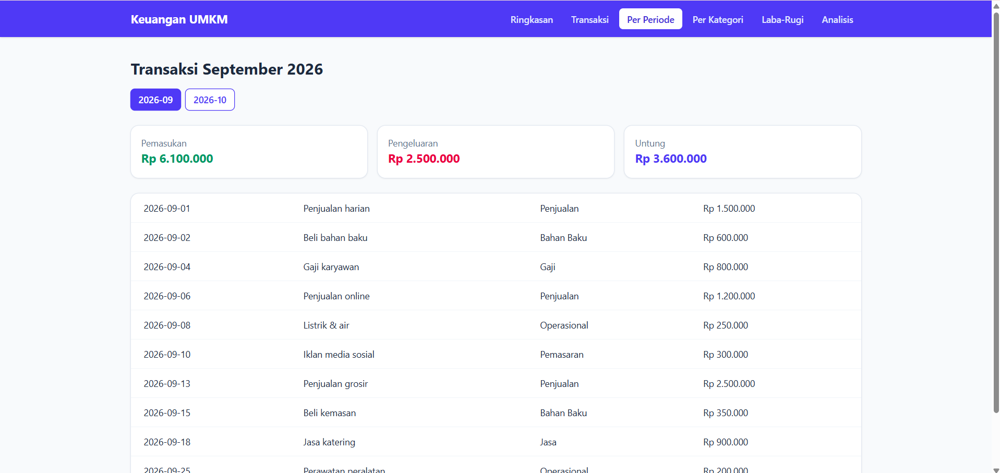
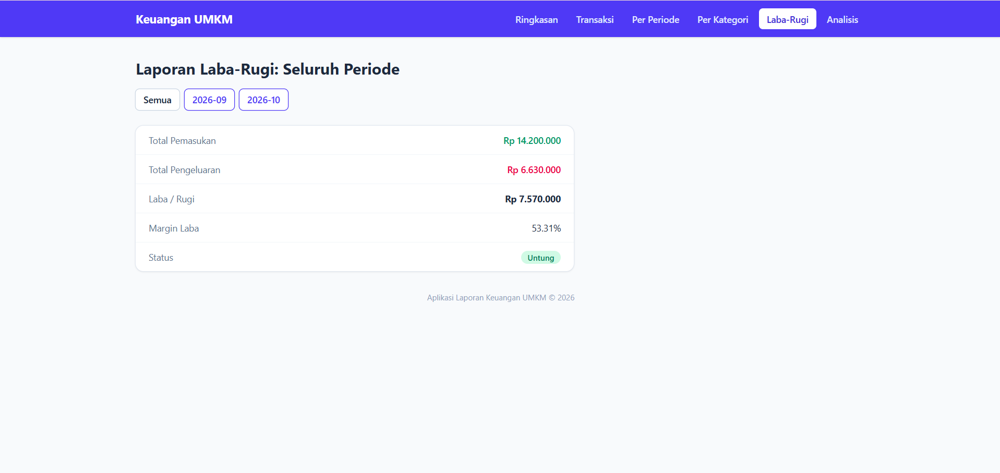
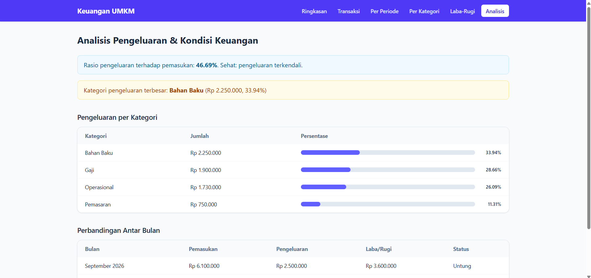

# Aplikasi Laporan Keuangan UMKM

Aplikasi web berbasis Laravel untuk mengolah transaksi harian UMKM, menghitung laba-rugi, dan menganalisis pengeluaran. Dibuat sebagai Ujian Tengah Semester mata kuliah Pemrograman Internet.

## Identitas Mahasiswa

Nama Lengkap     : Akbar Syam Al Ghamar
NIM              : C2483207013

## Tema Proyek

**Studi Kasus: Laporan dan Analisis Keuangan UMKM**

## Deskripsi Permasalahan dan Solusi

**Permasalahan:** Sebuah UMKM mencatat transaksi pemasukan dan pengeluaran setiap hari, tetapi pemilik usaha kesulitan mengetahui total keuntungan, kategori pengeluaran terbesar, serta perubahan kondisi keuangan dari satu periode ke periode berikutnya.

**Solusi:** Aplikasi web yang mengolah data transaksi (disimpan sebagai array PHP, tanpa database) untuk:

- menghitung total pemasukan, total pengeluaran, dan laba/rugi,
- mengelompokkan pengeluaran per kategori beserta persentasenya,
- membandingkan kondisi keuangan antar bulan,
- mengidentifikasi kategori pengeluaran terbesar,
- menilai kondisi keuangan (Sehat, Waspada, Kritis).

## Teknologi

- Laravel (PHP)
- Blade Template
- Tailwind CSS
- Data berupa array PHP (tanpa database dan tanpa autentikasi)

## Daftar Halaman

1. Ringkasan keuangan (halaman utama)
2. Daftar transaksi
3. Detail transaksi
4. Transaksi per kategori
5. Transaksi per periode (bulan)
6. Laporan laba-rugi
7. Analisis pengeluaran dan kondisi keuangan

## Implementasi Routing, Controller, dan Blade View

### Routing

Seluruh route ada di `routes/web.php`.

| Method | URL | Controller@method | Fungsi |
|---|---|---|---|
| GET | `/` | DashboardController@index | Ringkasan keuangan |
| GET | `/transaksi` | TransaksiController@index | Daftar transaksi |
| GET | `/transaksi/{id}` | TransaksiController@show | Detail transaksi |
| GET | `/kategori/{kategori}` | TransaksiController@perKategori | Transaksi per kategori |
| GET | `/periode/{bulan}` | TransaksiController@perPeriode | Transaksi per bulan (format `YYYY-MM`) |
| GET | `/laporan/laba-rugi` | LaporanController@labaRugi | Laba-rugi seluruh periode |
| GET | `/laporan/laba-rugi/{bulan}` | LaporanController@labaRugi | Laba-rugi per bulan |
| GET | `/laporan/analisis` | LaporanController@analisis | Analisis keuangan |

Parameter URL yang digunakan: `{id}`, `{kategori}`, dan `{bulan}`.

### Controller

| Controller | Tugas |
|---|---|
| `DashboardController` | Menyiapkan ringkasan total dan 5 transaksi terbaru |
| `TransaksiController` | Menampilkan daftar, detail, serta penyaringan berdasarkan kategori dan periode |
| `LaporanController` | Menghitung laporan laba-rugi dan analisis keuangan |
| `Controller` (base) | Berisi method perhitungan bersama: `hitungTotal`, `ringkasan`, `pengeluaranPerKategori`, `filterBulan`, `daftarBulan`, `namaBulan` |

Seluruh proses perhitungan, analisis, dan pengambilan keputusan dilakukan di Controller. Blade View hanya menampilkan hasilnya.

### Model

`App\Models\Transaksi` menyimpan 22 data transaksi (September dan Oktober 2026) dalam array PHP, dilengkapi method `semua()` dan `cariById()`.

### Blade View

Lokasi: `resources/views/`

```
layouts/app.blade.php        (layout utama + navigasi)
dashboard.blade.php
transaksi/index.blade.php
transaksi/show.blade.php
transaksi/kategori.blade.php
transaksi/periode.blade.php
laporan/laba-rugi.blade.php
laporan/analisis.blade.php
```

Struktur Blade yang dipakai: `@extends`, `@section`, `@yield`, `@foreach`, dan `@if`.

## Logika Perhitungan dan Analisis

| Perhitungan | Rumus |
|---|---|
| Total pemasukan | Jumlah semua transaksi berjenis `pemasukan` |
| Total pengeluaran | Jumlah semua transaksi berjenis `pengeluaran` |
| Laba / Rugi | Pemasukan − Pengeluaran |
| Margin laba | (Laba ÷ Pemasukan) × 100% |
| Persentase kategori | (Jumlah kategori ÷ Total pengeluaran) × 100% |
| Rasio pengeluaran | (Pengeluaran ÷ Pemasukan) × 100% |
| Perubahan laba antar bulan | (Laba bulan akhir − Laba bulan awal) ÷ \|Laba bulan awal\| × 100% |

### Analisis Kategori Pengeluaran

1. Transaksi berjenis pengeluaran dikelompokkan berdasarkan kategori dengan perulangan `foreach`, lalu dijumlahkan.
2. Hasilnya diurutkan dari terbesar ke terkecil dengan `arsort()`.
3. Elemen pertama hasil pengurutan adalah **kategori pengeluaran terbesar**.
4. Persentase tiap kategori dihitung terhadap total pengeluaran.

### Penilaian Kondisi Keuangan

Berdasarkan rasio pengeluaran terhadap pemasukan:

| Rasio | Status |
|---|---|
| Kurang dari 60% | Sehat |
| 60% sampai 90% | Waspada |
| Lebih dari 90% | Kritis |

### Penanganan Nilai Nol

- Jika pemasukan dan pengeluaran sama-sama 0, status menjadi "Belum ada transaksi".
- Jika pemasukan = 0, margin dan rasio diset 0 agar tidak terjadi pembagian dengan nol.
- Jika total pengeluaran = 0, persentase kategori diset 0.
- Jika laba bulan awal = 0, persentase perubahan diset 0.
- Periode tanpa transaksi menampilkan pesan, bukan error.

## Screenshot

### Ringkasan Keuangan


### Daftar Transaksi


### Detail Transaksi


### Transaksi per Periode


### Laporan Laba-Rugi


### Analisis Keuangan


## Petunjuk Menjalankan Aplikasi

**Kebutuhan:** PHP 8.3 atau lebih baru, Composer, dan koneksi internet (Tailwind CSS dimuat lewat CDN).

```bash
git clone https://github.com/abayysem/UTS-Pemrograman-Internet-C2483207013.git
cd UTS-Pemrograman-Internet-C2483207013
composer install
cp .env.example .env
php artisan key:generate
php artisan serve
```

Buka `http://127.0.0.1:8000` di browser.

Contoh URL untuk dicoba:

- `/transaksi/5`
- `/kategori/Penjualan`
- `/periode/2026-09`
- `/laporan/laba-rugi/2026-10`
- `/laporan/analisis`
